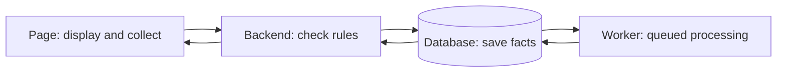

# Kyrie's GigMate learning guide: start from zero

Version 2.0 · 2026-10-12, Hong Kong time. For Kyrie, a first-year student learning programming and working on Role D.

[完整中文教程](../zh/kyrie-learning-guide.md) · [File map](kyrie-file-atlas.md) · [Page instructions](role-d-frontend-user-guide.md)

Learn one button before learning the whole repository. This revision explains a concrete problem before naming its technical mechanism, retains the seven original public GitHub screenshots, and moves advanced vocabulary to a lookup section. The Chinese guide provides the expanded, step-by-step lesson; this companion covers the same facts, rules and learning exercises.

## 0 A manageable first session

With 20 minutes, read the booking story and six terms, then do exercise A. Aim to explain something in your own words rather than finish every page.

| Session | Observable outcome |
| --- | --- |
| Product | Explain why a customer proposal is different from merchant approval |
| Files | Locate the button and the separate network request |
| Code | Explain why paging preserves hidden checkbox selections |
| A small change | Describe the effect, checks and remaining uncertainty |

Your ordinary project directory is on main `bbb0074`. D-02 is in a separate worktree, branch `codex/d02-workspace`, with preceding commit `4665692`. That commit was pushed under the earlier instruction but has no PR and is not merged into main. This product cleanup continues in the D directory. `git worktree list` shows the directories without changing them. Open `d02-workspace` to inspect current D code; main may still show the older UI. New-D GitHub links in the map refer to preceding `4665692` for location, not proof later local edits are uploaded.

Kyrie reports the team can now connect to WAHA. This is a team observation, not a new pairing test by this update. A working connection does not establish model extraction, order creation or message sending.

## 1 A booking story

You photograph a customer on Wednesday at 15:00. They ask to move to Thursday at 15:00, with the address to follow. Another job already occupies that time. GigMate should associate the message with the booking, flag the clash, keep the address missing, and wait for you to approve an available arrangement.

Customer proposal means what they want; customer confirmation means they explicitly accept it; merchant confirmation means you authorize changing your formal arrangement. AI drafts do not grant approval. A work order is a business record card: what, when, original evidence and unresolved details. One chat can discuss several orders, and an order can involve several chats.

Current D supports existing internal schedule confirmation. Internal calendar means GigMate's own saved entries, not iPhone/Google synchronization. Creation, completion, reply approval and sending depend on subsequent backend capabilities.

## 2 Six terms first

| Term | Plain meaning | GigMate location |
| --- | --- | --- |
| Frontend | The page you see and operate | `apps/web` |
| Backend | The program that receives requests and checks rules | `apps/backend` |
| Database | Long-term saved facts | Orders, consent and tasks |
| API | An agreed way for programs to ask and answer | Request the owned order list |
| State | A value the program currently remembers | Selected order or saving-in-progress |
| Component | A reusable part of a page | Chat choices or connection screen |

Saving authorization follows: collect all choices → request the backend → check account and version → save → read back. A green checkbox alone is not saved consent. WAHA connects WhatsApp; GigMate sign-in and phone pairing are separate operations.



The worker handles recorded pending work separately. Accepted input does not mean processing has completed.

## 3 GitHub actions are different

Git records versions; GitHub hosts collaboration.

| Action | Meaning |
| --- | --- |
| Edit | Change files on your computer |
| Commit | Record selected changes as a local version |
| Push | Upload commits for others to see |
| PR | Ask for review and possible integration into a named target |
| Merge | Integrate into the target branch |
| Fetch | Update your remembered remote positions without replacing current files |

A branch names a development line. A worktree is another checkout directory for the same repository. This explains why D changes can exist while main has older files. D-02's `4665692` was committed/pushed but has no PR and is not in main.

The following screenshots are original public pages from **2026-10-11**. Counts and status are dated teaching observations.


Check the branch before looking for a file. Selecting main on the website does not switch your local directory.


An Issue records a task or problem. Find the steps, actual behavior and expected behavior; a proposed cause is not a proven cause.


Open is unresolved, Draft is preliminary, Merged entered its target, and Closed can mean closed without merge.


Conversation holds discussion, Commits versions, Checks automated results, and Files changed the edits. #16 is a historical merged delivery.


Red removes, green adds. A large line count can include dependency records. Viewed means inspected, not approved.


The screenshot is `dcd7527`, not current D. A short identifier such as `4665692` locates a version; do not memorize it.


Open the failed job and its first failing step. A green check establishes only the checks run, not all devices or all possible behavior.

Read-only commands, from the repository directory:

```bash
git status --short
git branch --show-current
git diff
git worktree list
```

They answer: what changed, which branch, how it changed, and which directories exist. New untracked file contents do not appear in ordinary diff: locate them through status. `git diff --staged` shows the next commit's selected edits. Do not use destructive reset/clean or delete database volumes as a refresh operation.

## 4 Follow a small piece of code

Read main.tsx (starts the page), then App.tsx in the D directory (login and navigation), chat-choices.ts (filter/page calculation), ChatChoices.tsx (checkbox rows), WorkOrderWorkspace.tsx (review/calendar/tasks), workspace-api.ts (requests), waha-live-api.ts (authorization/control requests), and finally the long ConnectionWorkspace.tsx. Check the directory first; names can exist in several versions.

Teaching example only; do not overwrite project files:

```tsx
function Choice() {
  const [picked, setPicked] = useState(false);
  return (
    <button onClick={() => setPicked(!picked)}>
      {picked ? "Selected" : "Not selected"}
    </button>
  );
}
```

`useState(false)` initially remembers no selection; `setPicked` requests an update. `onClick` runs when clicked; `!` reverses the boolean; `condition ? A : B` chooses text. React redraws from the new value. This changes browser memory, not the database. `return` provides the result, `import` uses another file's feature, and `export` makes it available. TypeScript catches some data mistakes before running, not server-side permission violations.

17 chats at 8 per page need 3 pages: 1–8, 9–16, then 17. Array positions start at zero, so page two uses `slice(8,16)`. `filter` keeps matching items, `map` transforms each, `find` locates one, and `slice` takes a portion. Search uses already loaded choices; it does not discover phone chats. `choices` is the whole loaded catalog; `picked` is the whole intended selection. Saving after choosing A on page one and B on page two must send both.

## 5 Trace schedule confirmation

Read order/proposal/source → compare in the review panel → check explicit consent → send the observed versions → backend checks account, consent, source changes and conflict → update order/calendar/preparation tasks together → reread.

A version is a change marker: if you read v3 but another window saved v4, your v3 command must be rejected rather than overwrite it. Each message has a revision too; sources identify the exact message and revision. D-02 reads all linked chats and blocks confirmation when source context is ambiguous, missing or revoked.

Busy prevents duplicate commands; stale reads prevent approving obsolete information; changed proposals invalidate old consent; clashes prevent overlapping arrangements; unknown addresses remain missing; expired new chat choices require rediscovery. The backend checks again regardless of disabled buttons.

Timeout does not establish failure: a request might succeed while its answer is lost. Read/reconcile before another command. PR21 illustrates this distinction: cancelling result use does not prove external processing stopped. Losing its request record permits duplicate submission. That reproduction used a synthetic processor, not real billing.

## 6 Tools: remember their job

HTML structures the page; CSS arranges it; JavaScript implements interaction; TypeScript adds data checks and TSX permits page markup. React organizes components. Vite serves development pages and builds distributable files. Node runs frontend tooling; npm installs/runs it. FastAPI defines backend APIs; Uvicorn runs the service. PostgreSQL stores facts. Docker provides prepared service environments and Compose starts a group. pytest/Node test check behavior, while Prettier/Ruff check formatting and some code issues.

Learn JavaScript conditions, arrays and functions before React state/events. Backend tool names can wait until you trace a cross-layer flow.

## 7 Run and troubleshoot

Use the [page guide](role-d-frontend-user-guide.md) and [backend setup](getting-started.md). Choose your owned WAHA environment or an isolated test environment; never seed/reset a real installation for a lesson.

In the selected checkout:

```bash
cd apps/web
npm ci
npm run dev
```

`cd` changes directory, `ci` installs locked dependencies, and `dev` keeps a development service running. Use pinned Node 24.15.x/npm 11.12.x. For the default team backend, macOS/Linux:

```bash
GIGMATE_REAL_API_URL=http://127.0.0.1:18702 npm run dev
```

Think of the same page opening two separate notebooks: **真实连接** uses your actual local WAHA/business data; **隔离测试** uses fictional data in a separate database. The top button switches notebooks and asks you to sign in again; it does not copy or delete records. The login form displays public default development credentials. Defaults are real 18702 and isolated 18000; `GIGMATE_REAL_API_URL` / `GIGMATE_ISOLATED_API_URL` configure the respective destinations once. The page guide explains separate backend setup, alternate ports and PowerShell. Opening/switching a page does not start its backend or update the checkout.

After edits, in apps/web:

```bash
npm run check:api
npm run format:check
npm run build
```

These check API descriptions, formatting, then tests/types/build. Output `dist` is not deployment. From root, `.venv/bin/python scripts/check_baseline.py` checks documents/examples; `.venv` is the project Python environment, with Windows commands in setup docs.

Network in browser developer tools shows a request. Check destination, status and error; do not publish cookies/passwords/QR/customer text. Login failures require checking the GigMate account, password and backend. Empty orders can be truthful: connection alone creates none. 401 usually requires sign-in; 403 needs permission/validation investigation; 409 needs reread/review; timeout requires checking the outcome. Missing nicknames are not invented. Narrow overflow needs checking CSS/long text. Report version/environment, one action, actual result and expected result.

## 8 Four exercises and answers

A: Run branch/worktree read-only commands. Answer: D and main are separate checkout/development positions, so unmerged code can differ.

B: Hand-calculate 17/8 page three, then filter to two results. Answer: one result on page three, then clamp to page one; keep the full selection.

C: Read the cross-page save test in connection-workspace.test.mjs. Answer: saving only visible rows can revoke hidden selected chats. Real components with fake responses do not prove phone pairing.

D: Explain one help-text change in the correct D directory, inspect diff, run relevant checks. Answer: specify who sees it and what becomes clearer; passing build does not implement order creation. Do not casually change real consent/permission/save rules.

## 9 Vocabulary to look up later

Props are a child component's inputs; Hooks are React tools; DOM is the browser's drawn element tree; JSON is a textual data format; cookies/session maintain login. CSRF prevents another site abusing that login but does not replace ownership checks. IDs distinguish records even if names duplicate. A contract agrees fields/rules, generated files are tool outputs, persistence survives program restart, stale means insufficiently fresh. A race can let slow A arrive after newer B, so A must not replace B. Idempotency uses the same command identity/content without treating it as new; it is not permission for every resend. Fixtures are prepared test data, mocks simulated answers, regression tests protect a previous fix, CI automated checks, ADR recorded design reasons, proxy request forwarding.

Later backend lessons: a transaction groups related writes; a lease limits a worker's ownership in time; an outbox records future send work reliably. These mechanisms are not proof sending is implemented. contracts.py → export_contracts.py → domain schema/OpenAPI → generated/api.d.ts is the generation chain. Do not manually edit those three outputs; event/AI schemas are separate. SQLite tests do not prove PostgreSQL locking.

## 10 Learn with AI

Ask for a life example, inputs/result/caller, 10–20 lines at a time, plain meanings before terminology, and a prediction question before its answer. Then explain who a change affects and what proves it. Write three sentences after each session: the problem, rule, and verification. An unfamiliar word can be the whole next lesson.

## 11 Evidence and limits

Sources are local main `bbb0074`, D-02 `4665692`, this cleanup's source and the original learning materials. The preceding D-02 batch had 65 frontend tests; current checks after adding login/navigation regressions are recorded in [implementation status](implementation-status.md), not counted from old results. No new real-phone/model/send acceptance is claimed. Version 1.1 is backed up locally under ignored `local-data/kyrie-learning/before-product-cleanup-20261012/`. The seven screenshots remain original dated public images; [provenance](../learning-assets/README.md). Read the page guide for operation and the map for file lookup.
