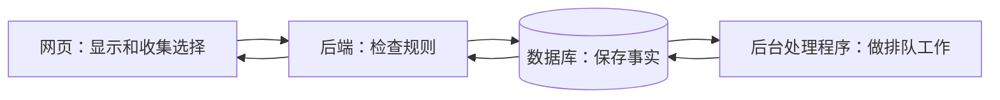
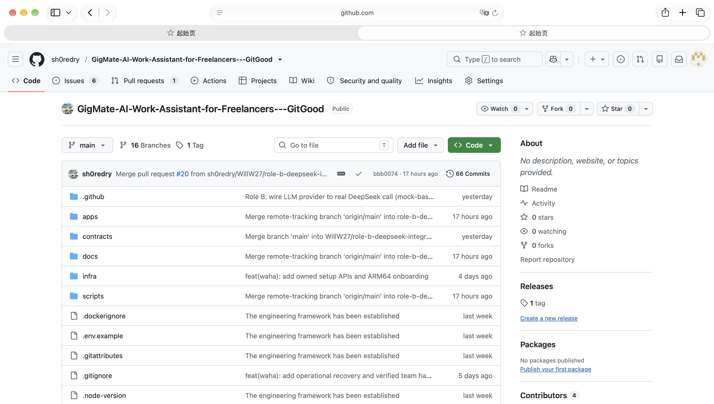
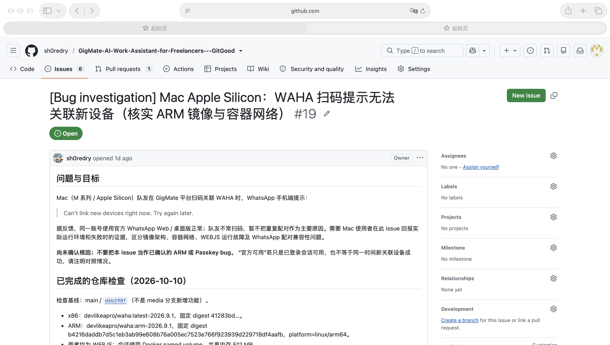
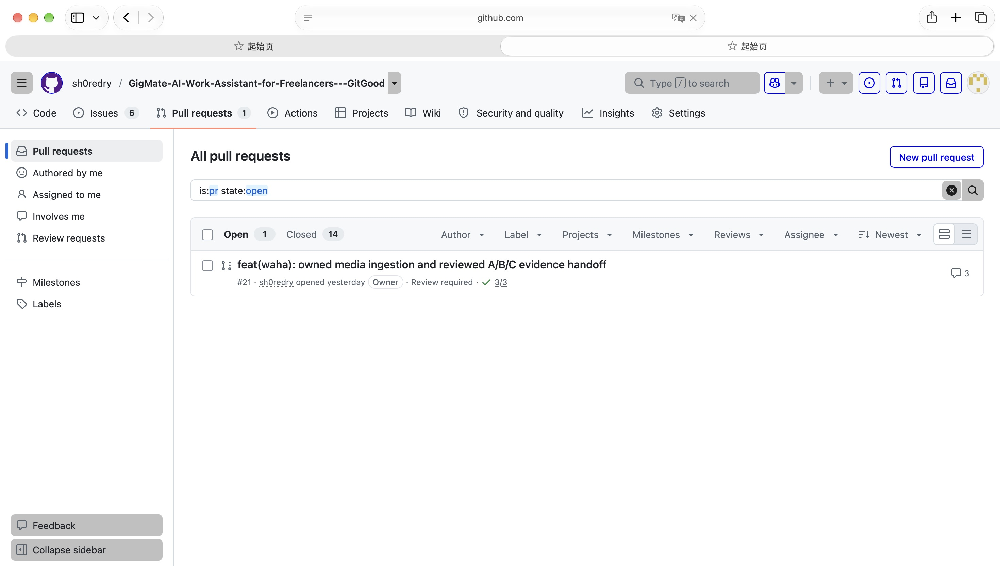
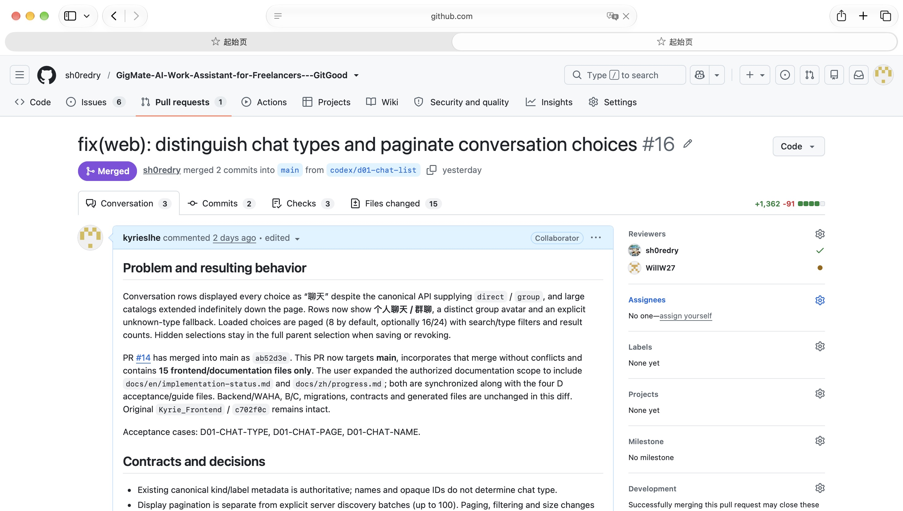
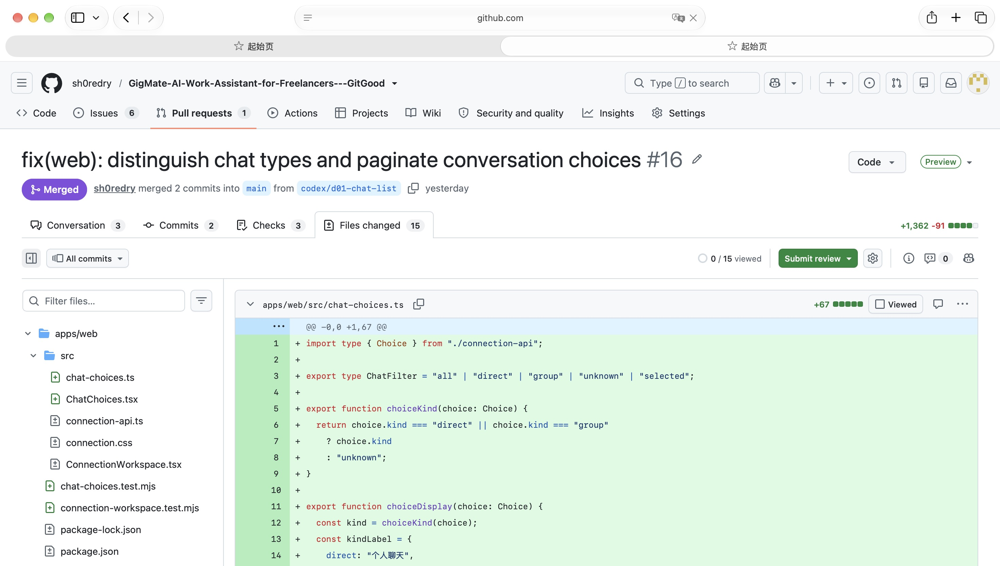
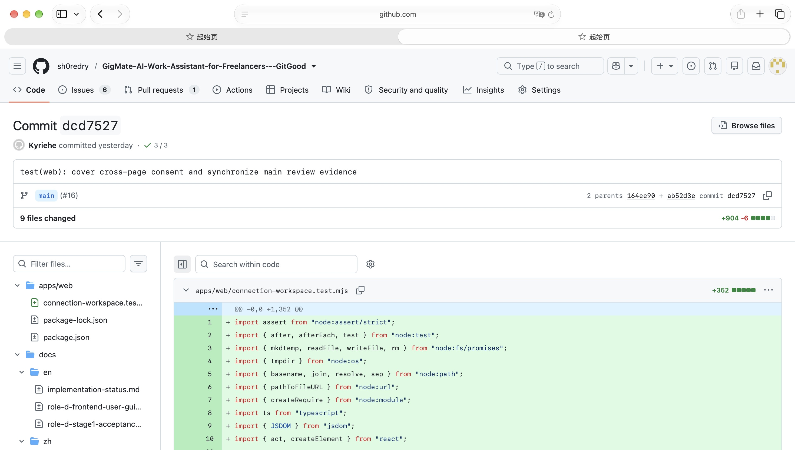
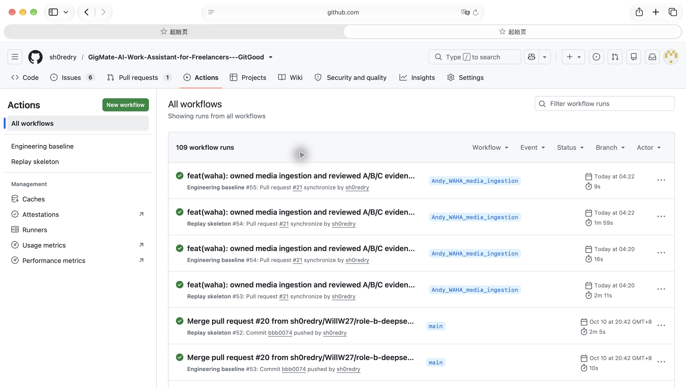

# Kyrie 的 GigMate 学习手册：从零开始

版本 2.0 · 2026-10-12（香港时间）。给大一、刚接触编程、负责前端的 Kyrie。

[English companion](../en/kyrie-learning-guide.md) · [查文件的地图](kyrie-file-atlas.md) · [页面操作手册](role-d-frontend-user-guide.md)

你现在不需要记住所有技术名词，也不用从第一行读到最后一行。先能解释一个按钮做了什么，再慢慢扩大范围。这次把原来较长的教程重新组织成入门版；原有七张 GitHub 截图保留，复杂机制放到后面查。

## 0 今天先学什么

如果只有 20 分钟：读第 1 节的故事、第 2 节的六个词，做第 8 节的第一个练习。做到“能用自己的话解释”，比读完很多页有用。

| 这次学习 | 结束时你能说什么 |
| --- | --- |
| 第一回：看产品 | “客户提出改期，不等于商户已经同意。” |
| 第二回：认文件 | “按钮在这个文件，网络请求在另一个文件。” |
| 第三回：看代码 | “翻页只改变显示的行，没有丢掉之前的勾选。” |
| 第四回：做小改动 | “我改了什么，怎样检查，哪些还没验证。” |

### 先分清你看的是哪个版本

你的普通项目目录在 `main`，已核对版本是 `bbb0074`。D-02 在**另一个工作目录**、分支 `codex/d02-workspace`，先前提交为 `4665692`。根据你的新要求，完整工作台、界面整理和环境切换现在准备提交 PR，仍需评审和合并才会进入 main。两个目录的代码可以不同，这是正常的。

`git worktree list` 能列出这些目录；这是只读命令。想看最新 D 界面代码，就打开其中的 `d02-workspace`，不要因为 main 里还有旧页面，就以为改动没做。地图中新 D 文件的 GitHub 链接指向先前 `4665692`，是定位参考，不代表后续本地改动已经上传。

你说大家已经能登录 WAHA，这是一条团队实测消息。本轮没有代替大家重新扫码；“能连接 WhatsApp”也不等于“模型能自动建单、系统能发回复”。

## 1 先看一个预约故事

假设你帮客户拍照，原约是星期三下午三点。客户发来：“改星期四三点，地址晚点给你。”你星期四三点已经有另一场拍摄。

我们希望 GigMate 做四件事：把这条消息和对应业务放在一起；指出时间撞了；保留“地址还没提供”；等你核对后再改正式安排。

| 页面里的事实 | 用人话说 |
| --- | --- |
| 顾客提出 | 客户想这样改 |
| 顾客已确认 | 客户明确认可这个方案 |
| 商户确认 | 你同意修改自己的正式安排 |
| 地址未提供 | 目前没有足够依据，不能编一个地址 |

AI 可以帮你整理和拟草稿，但不能替你点头。GigMate 的“工单”就是**一笔业务的记录卡**：做什么、什么时候、有哪些原话、什么还没确定。一段聊天可以讨论两笔业务，一笔业务也可能在两个聊天里讨论。

当前 D 页面只开放已有的内部排期确认。内部日历是 GigMate 自己保存的安排；不是已经同步到 iPhone 或 Google 日历。回复审批、正式发送、新建和完成工单还要等后续能力。

## 2 先认六个词就够了

| 词 | 普通说法 | 在 GigMate 里看哪里 |
| --- | --- | --- |
| 前端 | 你看见和操作的网页 | `apps/web`，主要由你负责 |
| 后端 | 接收网页请求、检查规则的程序 | `apps/backend` |
| 数据库 | 程序长期保存资料的地方 | 保存工单、授权、任务；不是浏览器上的文字 |
| 接口（API） | 两个程序说好怎样请求、怎样回答 | 网页请求“给我工单列表”，后端返回列表 |
| 状态（state） | 程序现在记着的值 | 选了哪张工单、是否正在保存 |
| 组件（component） | 一块可以组合的页面 | 连接页、工单详情、会话选择列表 |

比如你点“保存会话授权”：前端收集完整勾选 → 向后端接口提交 → 后端确认是你的账号、版本没变 → 保存进数据库 → 网页读回结果。把勾选框涂成绿色，本身不算保存成功。

WAHA 是帮助项目接通 WhatsApp 的服务。GigMate 登录是进入工作台；手机扫码是关联 WhatsApp。这是两件事，不能把 WhatsApp 手机密码当 GigMate 密码填。

### 四个部分怎样配合



后台处理程序在代码里叫 `worker`。假设一条消息需要整理，后端先把“要整理这条消息”保存下来，worker 再处理。所以“请求已接受”不等于“整理已完成”。

## 3 GitHub：把几个动作分开

Git 帮你记录代码变化，GitHub 是大家分享代码、讨论和评审的网站。它们不是同一个东西。

| 动作 | 像什么 | 实际作用 |
| --- | --- | --- |
| 编辑 | 修改笔记 | 改电脑里的文件 |
| commit | 存一个有说明的版本 | 记录当前选定的修改；通常只在本机 |
| push | 上传保存的版本 | 队友在 GitHub 能看到 |
| PR | 请别人检查，再考虑收进主线 | 有源分支、目标分支、修改说明和评审 |
| merge | 收进目标分支 | 例如让功能进入 `main` |
| fetch | 看远端有没有更新 | 更新电脑对远端的记录；不会直接替换当前文件 |

所以“commit 就好”和“发 PR”是不同要求。D-02 现在准备提交给队友评审；即使完成 commit、push 和创建 PR，也不等于已经 merge 到 main。

分支是给一条开发路线起名字；`main` 是团队主线。工作目录是你现在实际打开的文件夹；`worktree` 是同一仓库的另一个工作目录，方便在不打扰原目录的情况下做另一条路线。

### 看图认识网站，不用背菜单

以下是 **2026-10-11** 的原始公开 GitHub 截图，数量、状态可能后来变化；这里教你找位置，不把图当今天的状态。



**Code**：先看分支名称，再找文件。网站选了 main，不会让你电脑也自动切到 main。点文件旁的提交说明，可以看它上次怎样改。



**Issue** 是问题或任务记录。先找“怎么操作、实际怎样、应该怎样”。讨论中提出的猜测，还不是查明的原因。



**Pull requests** 是改动评审列表。Open 表示还开着；Draft 表示草稿；Merged 表示合进去了；Closed 可能只是关闭、没有合并。



看自己的 **PR #16**：先看改动要合到哪里，再看说明。Conversation 看讨论；Commits 看版本记录；Checks 看自动检查；Files changed 看具体修改。#16 已合入 main，这是历史交付。



**Diff** 就是“前后有什么不同”。红色删旧内容，绿色加新内容。新增行多不一定功能多，依赖记录也占很多行。标记 Viewed 只是看过，不是批准。



**Commit 页面** 能看到版本说明和修改。截图对应 `dcd7527`；不是当前最新 D 提交。像 `4665692` 这样的短串是定位版本的编号，不用背。



**Actions** 是自动跑检查的地方。红叉时，打开失败任务，找第一个实际报错的步骤。绿勾说明这组检查通过，不等于所有手机都能连接，也不等于没有遗漏。

### 先会四个只读命令

在项目目录里运行，每次先看输出再继续：

```bash
git status --short
git branch --show-current
git diff
git worktree list
```

依次回答：有哪些修改？我在哪个分支？具体改了什么？有没有其他工作目录？`git diff` 默认不显示未跟踪新文件的正文；新文件从 `git status` 找到后打开读。要看准备提交的内容，用 `git diff --staged`。

先不要使用会丢改动的 `git reset --hard`、`git clean -fd`，也不要把删除数据库卷当重启。遇到不懂的命令，先问它会改哪个东西。

## 4 你先读哪些文件

| 顺序 | 文件 | 只找一件事 |
| --- | --- | --- |
| 1 | `apps/web/src/main.tsx` | 它把整个网页启动起来；新整理版把页面逻辑拆到 `App.tsx` |
| 2 | `apps/web/src/App.tsx`（D 工作目录） | 有没有登录？现在显示业务页还是连接页？ |
| 3 | [chat-choices.ts](../../apps/web/src/chat-choices.ts) | 怎样筛选和分成每页 8 条 |
| 4 | [ChatChoices.tsx](../../apps/web/src/ChatChoices.tsx) | 怎样把列表画成可勾选的行 |
| 5 | `WorkOrderWorkspace.tsx`（D 工作目录） | 工单原文、变更、确认面板、日历和待办在哪里 |
| 6 | [workspace-api.ts](../../apps/web/src/workspace-api.ts) | 页面怎样请求数据、处理报错 |
| 7 | [waha-live-api.ts](../../apps/web/src/waha-live-api.ts) | 怎样保存授权和核对未确定的连接操作 |
| 8 | [ConnectionWorkspace.tsx](../../apps/web/src/ConnectionWorkspace.tsx) | 连接、二维码、授权怎样组织在一起；最后再读这个长文件 |

同名文件在 main 和 D 工作目录可能不同。先确认目录，再找函数，不要拿截图的行号硬找。详细地图覆盖其他文件，但第一天不用全看后端。

### 一个最小 React 例子

这是教学例子，**不要直接覆盖项目文件**：

```tsx
function Choice() {
  const [picked, setPicked] = useState(false);
  return (
    <button onClick={() => setPicked(!picked)}>
      {picked ? "已选择" : "未选择"}
    </button>
  );
}
```

- `function Choice()`：定义一块页面。
- `useState(false)`：最初记着“没选”，得到当前值 `picked` 和改值的方法 `setPicked`。
- `onClick`：按钮被点击时做这件事。`!picked` 是把“是”改成“否”，或把“否”改成“是”。
- `picked ? A : B`：选了显示 A，否则显示 B。
- 调用改值的方法后，React 会按新值更新页面。这个例子只改浏览器内的值，没有写数据库。

这里的 `return` 是把结果交出去；`import` 是从别的文件拿功能；`export` 是让别的文件能拿这个功能。React 帮我们组织页面；TypeScript 帮我们提前发现一部分数据用错的问题，例如该传数字却传了文字。它不能代替后端检查账号权限。

### 会话分页：先手算再读代码

有 17 条会话，每页 8 条：第一页面 1–8，第二页面 9–16，第三页面 17，共 3 页。数组位置从 0 开始，所以第 2 页用 `slice(8, 16)` 取位置 8 到 15。

`filter` 是只留下符合条件的项；`map` 是把每项转换一下；`find` 是找一项；`slice` 是取一段。例如搜索“摄影”，不是去手机发现新聊天，只是在已载入列表里留下匹配项。

`choices` 是全部已载入会话，`picked` 是全部打算保存的勾选；页面只显示其中一页。第 1 页选 A，第 2 页选 B，保存时必须提交 A 和 B，不能只提交当前看得见的 B。已有测试专门保护这件事。

## 5 跟着“确认安排”走一遍

1. 页面读到某张工单和一条改期提议，同时读到它依据的消息。
2. 你打开核对面板，对比新旧时间、来源和版本。
3. 明确勾选后，页面请求后端确认；请求带着你看到的版本号。
4. 后端再次检查账号、授权、消息是否已变、是否撞期。
5. 成功后一起改工单、内部日历和准备待办，再让页面重新读取。

“版本”可以理解成修改次数的标记。你看的是工单 v3；另一个窗口已经改成 v4。你用 v3 提交时，后端要拒绝，让你看新内容，不能默默覆盖别人的修改。

消息也有自己的修订号：原文第一版是 r1，修改后是 r2。**来源**不是“聊天里说过”，而是“哪条消息的哪一版”。D-02 会读取全部关联会话；无法确定来源来自哪个会话，或那一版已经撤回，就不允许确认。

### 为什么页面有这么多“不能点”

| 页面情形 | 为什么拦住 |
| --- | --- |
| 正在保存 | 连点可能发出两次命令 |
| 读取失败，显示旧数据 | 你可能在批准过期方案 |
| 提议更新，旧核对失效 | 你勾选同意的是旧内容，不是后来换的新内容 |
| 时间冲突 | 不能同时安排两场重叠预约 |
| 地址没有依据 | 不能填一个看起来合理但实际不知道的地址 |
| 新会话选择过期 | 先重新发现、核对，再授予读取权限 |

如果请求超时，不一定没成功：服务可能已处理，只是答复没到网页。先刷新核对事实，别连点。PR21 的取消问题也是这个道理：用户取消采用结果，不代表外部处理已经停止；丢掉原请求记录后重新提交，可能重复处理。这个例子是在模拟处理器里复现的，不是真实扣费记录。

## 6 技术名字：先知道它负责什么

| 名字 | 你可以先这样记 |
| --- | --- |
| HTML | 页面有什么：标题、输入框、按钮 |
| CSS | 页面怎样排、什么颜色、窄屏怎样换行 |
| JavaScript | 点击后怎样行动、计算、请求数据 |
| TypeScript / TSX | 给 JavaScript 加检查；TSX 允许在代码里写页面结构 |
| React | 把页面拆成组件，数据变了就更新显示 |
| Vite | 开发时开网页服务，交付时把网页代码整理成文件 |
| Node.js | 让电脑运行前端开发、测试和打包工具；不是我们的 Python 后端 |
| npm | 安装前端工具，执行项目写好的命令 |
| FastAPI / Uvicorn | 后端接口工具／运行后端服务的程序 |
| PostgreSQL | 项目正式运行使用的数据库 |
| Docker / Compose | 把服务按准备好的环境运行／一起启动多个服务 |
| pytest / Node test | 自动检查后端／前端行为的工具 |
| Prettier / Ruff | 前端／后端的代码格式和部分问题检查工具 |

“技术栈”就是项目选用了哪些工具，不是需要一口气学完的课程。先学 JS 的条件、数组和函数，再学 React 的状态与事件。后端工具先知道用途就够了。

## 7 怎么运行，怎么判断哪里出错

启动步骤见[前端操作手册](role-d-frontend-user-guide.md)，完整后端准备见[开发入口](../en/getting-started.md)。先确认是自己的团队 WAHA 环境还是独立测试环境，别把虚构工单种进真实数据库。

在当前要改的工作目录打开终端，进入前端目录：

```bash
cd apps/web
npm ci
npm run dev
```

`cd` 是换目录；`npm ci` 按项目记录的固定版本安装工具；`dev` 开发服务持续运行，直到你停止它。用项目固定 Node 24.15.x／npm 11.12.x，不要遇到错误就随意升级所有依赖。

连接自己的团队后端，在这个前端目录运行：

```bash
GIGMATE_REAL_API_URL=http://127.0.0.1:18702 npm run dev
```

可以把网页想成同一本书的封面，把环境想成两本分别记账的本子：**真实连接**记你自己的 WAHA 和本机业务；**隔离测试**记独立数据库里的虚构练习。顶部按钮一次切换，换完重新登录，不会把一本的数据搬到另一本，也不会删除它。登录页重新写出了公开默认开发账号／密码。隔离测试只有业务工作台；要用 **WhatsApp 连接**，先切到真实连接环境。默认真实端口 18702，隔离端口 18000；`GIGMATE_REAL_API_URL` 和 `GIGMATE_ISOLATED_API_URL` 分别设置这两个地址，只需启动时配置一次。两套后端仍需分别准备，实际端口／PowerShell 写法见操作手册。打开或切换网页不会自动启动后端，也不会把 main 变成 D 工作目录。

修改后，在前端目录运行：

```bash
npm run check:api
npm run format:check
npm run build
```

依次检查：前端的数据说明是否和后端一致；格式是否统一；测试、类型检查和打包是否成功。`build` 的产物在 `dist`，不是已发布给所有人的网站。

根目录里的 `.venv/bin/python scripts/check_baseline.py` 检查文档链接和样例；`.venv` 是项目自己的 Python 工具环境。Windows 路径不同，请看开发入口。命令要在对应目录运行，不懂报错先看是不是走错目录。

### 报错时一次只追一个按钮

浏览器开发者工具的 Network 能看到网页请求。看地址、是否成功、错误内容，不要公开复制 Cookie、密码、二维码或真实客户原文。

| 现象 | 先检查 |
| --- | --- |
| 登录失败 | 是 GigMate 账号吗？密码对吗？后端启动了吗？ |
| 能登录，没有工单 | 这个账号可能确实没有工单；连接成功不会自动生成工单 |
| 401 | 通常是没有有效登录；重新登录 |
| 403 | 没有权限或请求验证没通过；查原因，不要关闭验证 |
| 409 / 版本变化 | 先读最新数据再核对；不要强行覆盖 |
| 请求超时 | 结果可能未知；先核对，不当成肯定失败 |
| 名字只剩号码 | 上游没提供昵称；前端不能编一个 |
| 窄屏横向滚动 | 检查固定宽度和长文字；不要只看大屏 |

写问题时用“四句话”：我在哪个版本／环境；点了什么；实际看到什么；应该看到什么。比“它坏了”容易帮助队友。

## 8 四个练习，附答案

### A：只读检查（今天就能做）

运行 `git branch --show-current` 和 `git worktree list`。写出 main 与 D 工作目录的区别。先不用切分支，也不发布任何东西。

答案：分支决定一条开发路线，工作目录是打开的文件位置；D 的新代码尚未合入 main，所以两处页面可以不同。

### B：纸上分页

17 条，每页 8 条，第三页显示几条？搜索后只剩 2 条，应该留在第 3 页吗？

答案：第三页 1 条；筛选后回到有效的第 1 页。翻页只改显示，完整勾选仍保留。

### C：读一个测试

打开 `apps/web/connection-workspace.test.mjs`，找跨页选择和保存的测试。写一句话：“如果这段保护没了，用户会……”。不需要先理解所有测试语法。

答案：如果保存只带当前页，用户之前在其他页选的会话可能被无意撤销。测试画的是真组件，但网络是准备好的假回答；不能拿它证明真实手机扫码成功。

### D：解释一个很小的修改

在正确的 D 工作目录，挑一句帮助文字，先写“哪些用户会看到、改后会更清楚什么”。修改后看 diff，运行适用检查，再解释结果。学习时不要随便改权限、保存条件或真实授权；它们需要先理解业务和测试。

答案示例：“我把空工单说明写清楚。没有工单的用户会看到它。不会凭空建单。格式／构建通过，但这不等于新建功能完成。”

## 9 后面遇到这些词，再回来查

| 词 | 人话解释与项目例子 |
| --- | --- |
| Props | 父页面给小组件的输入，例如完整会话列表 |
| Hook | React 给组件的工具，如 `useState` 记数据；不用把“钩子”想成硬件 |
| DOM | 浏览器实际画出的元素结构；开发者工具能查看 |
| JSON | 请求中常用的文字数据格式，如 `{"expected_version":3}` |
| Cookie / session | 浏览器和后端记住本次登录的方式；不是 WAHA 密钥 |
| CSRF | 防止别的网站借你已登录的身份偷偷发命令；项目还需检查账号权限 |
| UUID / id | 用来辨认同一条记录的编号；名字可能重复，编号不能当名字猜 |
| contract / 契约 | 前后端说好的字段与规则；例如都叫 `expected_version` |
| generated / 生成文件 | 工具按源代码做出的文件；应该改源，不是手改结果 |
| persistence / 持久化 | 存下来，程序重启后还能读；网页临时状态不是这种保证 |
| stale / 过期 | 数据不够新，不能用它确认安排 |
| race / 先后竞争 | 先点 A 后点 B，A 的慢回答反而最后到；不能用 A 覆盖 B |
| idempotency / 幂等 | 同一次命令用同一编号和内容核对，不误当成新命令；不是任何重发都安全 |
| fixture / mock | 准备好的测试数据／模拟的服务回答；用来稳定复现问题 |
| regression / 回归测试 | 留下一个检查，防止修好的问题以后又出现 |
| CI | GitHub 自动运行检查；绿勾只证明已运行的检查通过 |
| ADR | 记录“为什么选这个技术和规则”的文档；不是今日任务列表 |
| proxy / 代理转发 | 开发网页把接口请求转给配置的后端；不改变它的数据来源 |

下面三类知识留到跨后端学习时再看：**事务**让工单、日历、待办一起成功或一起撤销；**租约**让 worker 只在有限时间内负责某项工作，崩溃后能接手；**发件箱**把未来待发送工作先可靠记录下来，再执行和核对。不要把这些词当已开放外发功能的证据。

生成链：后端 `contracts.py` 定义数据 → `export_contracts.py` 输出 domain schema 和 OpenAPI → 前端工具生成 `generated/api.d.ts`。这三个生成结果不能手改；事件和 AI 的说明文件另行维护。SQLite 是部分测试使用的另一个数据库，它通过不证明 PostgreSQL 的并发锁正确。

## 10 怎样和 AI 一起学

可以直接这样问：

```text
我刚开始学编程。请先用一个生活例子解释这个函数，
再告诉我它的输入、结果、谁调用它。
一次只解释 10–20 行，专业词先用人话说。
给我一道预测题，等我回答，再解释答案。
最后让我自己说这次修改影响谁、怎么验证。
```

学完写三句：今天的问题是什么；代码用什么规则解决；我用什么检查确认。暂时没懂很正常，把不懂的词圈出来，下一次就只学它。

## 11 这份手册的依据与限制

依据本地 main `bbb0074`、D-02 `4665692` 及本次前端整理代码、原有学习资料和截图。2026-10-12 前一轮 D-02 有 65 项前端测试；本次新增登录／入口检查，当前结果以[最新验收记录](../en/implementation-status.md)为准，不把以前成绩算作新验证。这里没有替你重测真实手机、启用模型或发送客户消息。

旧 1.1 稿已备份在本机忽略目录 `local-data/kyrie-learning/before-product-cleanup-20261012/`，不上传私有运行资料。七张公开截图是旧原件，不是这次新拍的界面。[截图出处](../learning-assets/README.md)。当前能力和操作步骤看前端手册；需要查很多文件时再用地图。
